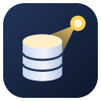
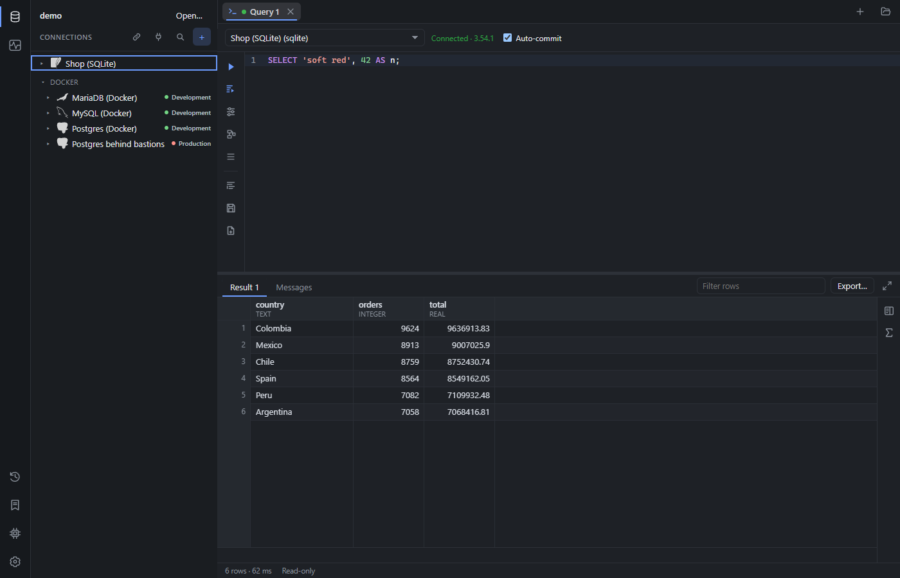
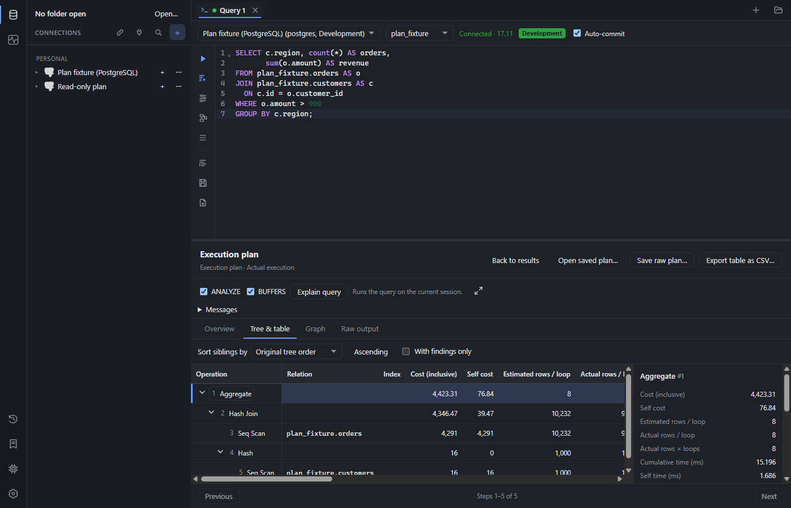

<p align="center">
  
</p>

<h1 align="center">SpelaionDB</h1>

<p align="center">
  An open-source desktop database client: fast and lightweight, with first-class SSH tunnels<br>
  and a built-in MCP server for AI agents. Part of the <a href="https://spelaion.dev">Spelaion</a> family.
</p>

<p align="center">
  <a href="https://github.com/spelaion-dev/spelaiondb/releases/latest"></a>
  <a href="https://github.com/spelaion-dev/spelaiondb/actions/workflows/ci.yml"></a>
  <a href="LICENSE"></a>
  <a href="https://ko-fi.com/spelaion"></a>
</p>



> **Status:** preview. The drivers (PostgreSQL, MySQL/MariaDB and SQL Server with TLS, SQLite,
> DuckDB), SSH tunnels, `spelaiondb mcp` and the desktop app work. Installers are not signed yet.

## What it does

- **Six engines:** PostgreSQL, MySQL, MariaDB, SQL Server, SQLite and DuckDB, including a
  SQLite file that lives on a server.
- **SSH tunnels built in:** several hops, an SSH agent (Pageant included), keys, passwords and
  2FA, SOCKS5 and HTTP proxies, and Kubernetes port-forwarding. A changed host key is always a
  blocking error.
- **Connections your team shares through git:** plain files in `.spelaion/` that never hold a
  password. A connection someone else changed is not used until you have seen what changed.
- **An MCP server for AI agents:** read-only unless you allow writes on a connection, never
  destructive, and every call is recorded. One click sets it up in Claude Desktop, Claude Code,
  Codex, Cursor, Windsurf and Antigravity.
- **An editor and a grid for long days:** run the statement under the cursor or a whole
  script, transactions you control, autocompletion, a command palette, sorting, filtering and
  exports that stream to a file, table data you edit in place, and file imports.
- **Execution plans** on every engine, as an overview, a tree, a graph or the raw output.
- **Safeguards:** Production connections confirm data changes, risky statements (`DROP`,
  `DELETE` without `WHERE`…) ask first, and read-only connections refuse to write.
- **Bring your connections:** import from DBeaver, DataGrip, TablePlus, HeidiSQL, MySQL
  Workbench, pgAdmin and Beekeeper Studio.



## Install

Download the installer for your system from the
[releases](https://github.com/spelaion-dev/spelaiondb/releases):

- **Windows:** `SpelaionDB_<version>_x64-setup.exe` (current user, no admin rights) or the
  `.msi`. Not signed yet: SmartScreen may ask, "More info" → "Run anyway".
- **macOS:** the `.dmg` for Apple Silicon (`aarch64`) or Intel (`x64`). Not notarized yet:
  right-click → Open the first time.
- **Linux:** `.deb`, `.rpm` or AppImage.
- **CLI and MCP server:** the `spelaiondb-<version>-<target>` archives hold the `spelaiondb` binary.

The app tells you when a new version is out and installs it when you ask.

## For AI agents (MCP)

`spelaiondb mcp` gives an agent access to the connections you mark as exposed to AI agents.
The app's **MCP server** page sets it up in your AI client; from a terminal, for Claude Code:

```bash
claude mcp add spelaiondb -- spelaiondb mcp
```

What agents may and may not do is in the [guide](docs/guide/mcp.md).

## Documentation

- **[User guide](docs/guide/README.md):** [connections](docs/guide/connections.md),
  [sharing them with a team](docs/guide/team.md), the [explorer](docs/guide/explorer.md),
  [running SQL](docs/guide/editor.md) (with the keyboard shortcuts),
  [results](docs/guide/results.md), [saved queries and history](docs/guide/saved-queries-and-history.md),
  [AI agents](docs/guide/mcp.md) and [settings](docs/guide/settings.md).
- **[Release notes](docs/releases/):** what each version added.
- **[Architecture](docs/architecture.md)** and the **[decisions](docs/adr/README.md)** behind it.

## Build from source

With Rust, Node and the [Tauri prerequisites](https://tauri.app/start/prerequisites/):

```bash
python examples/demo/make-shop-db.py
```

```bash
cd apps/desktop && npm install && npm run tauri dev -- -- ../../examples/demo
```

`examples/demo` ships a local SQLite database and, if you start `testing/docker`, a direct
PostgreSQL, MySQL, MariaDB and SQL Server, and a PostgreSQL behind two SSH bastions with TLS.

## Contributing

Bug reports, ideas and pull requests are welcome: see [`CONTRIBUTING.md`](CONTRIBUTING.md) for
how to build, test and send changes (against `dev`, with every commit signed off). Report
security problems privately, as [`SECURITY.md`](SECURITY.md) explains, never in an issue. Taking
part means following the [code of conduct](CODE_OF_CONDUCT.md).

Most of the code is written by AI coding agents following [`AGENTS.md`](AGENTS.md); the
compiler, the tests and CI are its reviewers.

## Support

SpelaionDB is free and always will be. If it saves you time, you can buy me a coffee on
[Ko-fi](https://ko-fi.com/spelaion): it goes into the next release.

## License

[Apache License 2.0](LICENSE).
